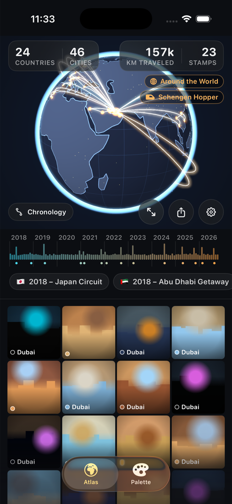
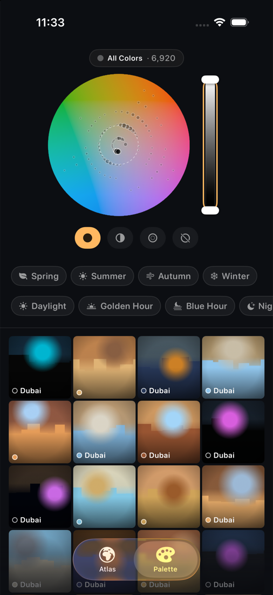

<p align="center">
  <picture>
    <source media="(prefers-color-scheme: dark)" srcset="Branding/logo/kit/master/lockup-horizontal-on-dark.svg">
    
  </picture>
</p>

<p align="center"><b>Your camera roll as an atlas of places and light.</b><br>
An offline-first iOS app that turns the GPS and colors already in your photos into a 3D travel globe and a mood-based color explorer.</p>

<p align="center">
  
  &nbsp;&nbsp;
  
</p>

## What it does

- **Rebuilds your travels automatically.** ChromAtlas finds your home base, groups the photos you took away from home into trips, and draws great-circle flight arcs and ground routes between stops. Countries, cities, kilometers, passport stamps and regional badges (GCC Explorer, Schengen Hopper, East Asia Circuit and more) are worked out from photos you already have. Short single-point airport layovers don't count as visits.
- **Lets you search by mood.** Every photo gets up to three dominant colors in OKLab, so even a small neon sign in a night shot can be found. Pick a hue and saturation on the wheel, narrow the brightness, and use a harmony mode: single hue, complementary, analogous or monochrome.
- **Knows the light and the season.** Golden hour, blue hour, daylight and night come from the sun's elevation at each photo's time and place. Seasons flip for the southern hemisphere.
- **Filters in both directions.** Tap a trip, city or year and the color wheel shows that slice's palette. Pick a color and the globe highlights the places and routes where you shot it.
- **Makes share cards.** Exports a dark summary card with your stats, a mini globe and a photo grid. The card is a newly rendered image, so it carries no GPS or photo metadata and names places only at city level.

## Privacy

Everything happens on the device. The app contains no networking code, no analytics and no accounts. Thumbnails are read only from what's already on the phone; iCloud originals are never downloaded. The index lives in the app sandbox and is excluded from backups. Reverse geocoding uses a city database bundled with the app.

## Requirements

- Xcode 27 (tested with 27.2); runs on iOS/iPadOS 18+
- [XcodeGen](https://github.com/yonaskolb/XcodeGen) (`brew install xcodegen`)
- No third-party Swift packages

## Build and run

```bash
xcodegen generate
open ChromAtlas.xcodeproj
```

In the Simulator, tap **Explore the Demo Atlas**. It loads a deterministic synthetic library of about 6,900 photos, 14 trips and 24 countries that goes through the same geo, solar and trip pipeline as real photos. On a device, tap **Index My Library** to analyze your own photos.

To install on your own iPhone, change `DEVELOPMENT_TEAM` in `project.yml` to your team ID, then run `xcodegen generate` again.

## Tests

```bash
xcodebuild -project ChromAtlas.xcodeproj -scheme ChromAtlas \
  -destination 'platform=iOS Simulator,name=iPhone 17 Pro' test
```

The tests cover OKLab round-trips, k-means accent detection, offline reverse geocoding, great circles, solar phases, hemisphere seasons, trip detection with layover suppression, color and harmony matching, and a 100,000-asset query timing check. That check allows < 16 ms in Release builds, which measured about 3.5 ms on the Simulator.

## Project layout

| Area | Where | What |
| --- | --- | --- |
| Color | `ChromAtlas/Core/Color` | OKLab conversion, k-means (k = 3) on 32×32 samples, named hue zones |
| Geo | `ChromAtlas/Core/Geo` | SQLite R*Tree reverse geocoder, haversine and great-circle math, country and region tables |
| Solar | `ChromAtlas/Core/Solar` | NOAA-style solar elevation, solar phases, seasons |
| Trips | `ChromAtlas/Core/Trips` | Home-base detection, spatio-temporal DBSCAN stops, layovers, flight and ground legs, badges |
| Query | `ChromAtlas/Core/Filter` | Columnar in-memory index for cross-filtering |
| Indexing | `ChromAtlas/Core/Indexing` | PhotoKit batches, 64 px fast thumbnails, thermal throttling, background processing, change observer |
| Store | `ChromAtlas/Core/Store` | Dependency-free SQLite wrapper and the `asset_index` table |
| UI | `ChromAtlas/UI` | Globe and HUDs, timeline and chapter chips, color wheel, filters, photo grids, share card, full-screen map |
| Branding | `Branding/logo` | Logo kit, app icons and guidelines |

## Using the full city database

The app ships with about 420 hand-picked cities. To use GeoNames' ~25,000 cities instead, download the data on your Mac (the app itself never goes online) and build `geo.sqlite`:

```bash
curl -O https://download.geonames.org/export/dump/cities15000.zip
curl -O https://download.geonames.org/export/dump/admin1CodesASCII.txt
unzip cities15000.zip
python3 Scripts/build_geodb.py cities15000.txt admin1CodesASCII.txt ChromAtlas/Resources/geo.sqlite
xcodegen generate
```

When `geo.sqlite` is in the app bundle, it replaces the built-in seed.

## Known limitations

- A photo's country comes from the nearest city within 350 km, not from real borders. Natural Earth country and state polygons aren't wired in yet.
- Globe coastlines are hand-simplified outlines.
- The R*Tree lookup doesn't wrap across the ±180° meridian.
- The PRD target of indexing 25,000 photos in under 45 seconds hasn't been measured on a real device yet.
